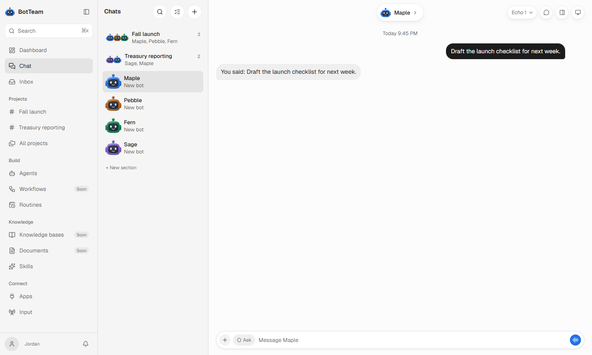
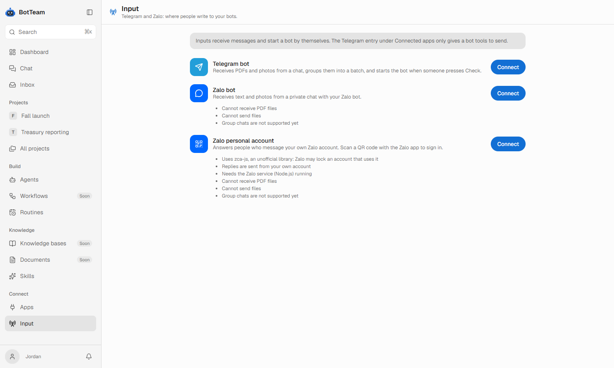
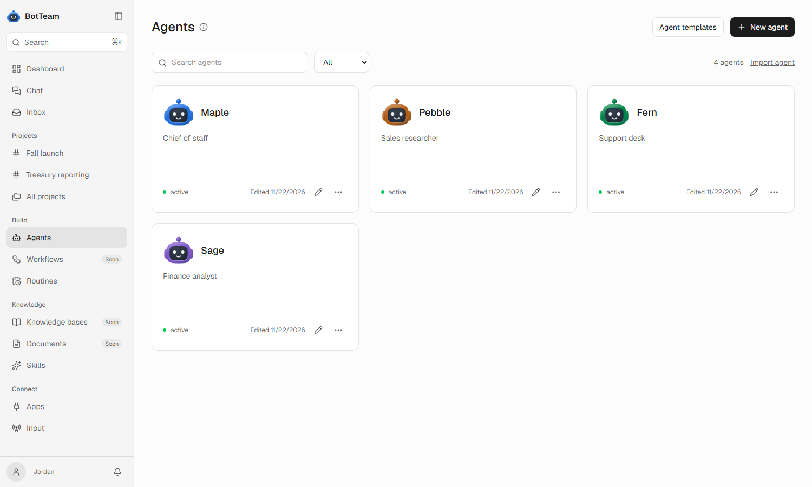
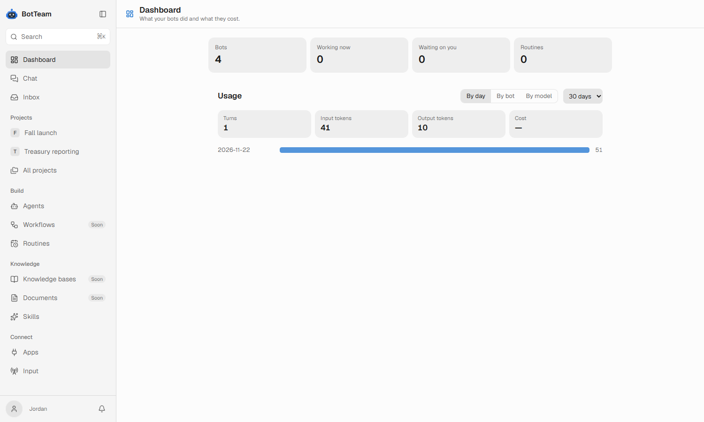
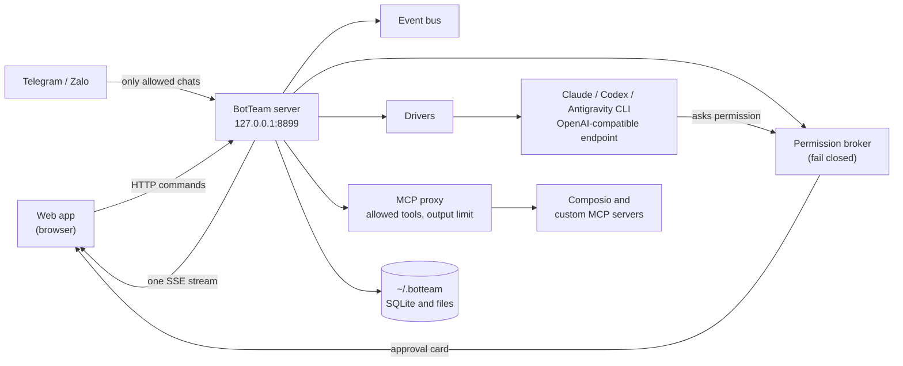

# **BotTeam**

BotTeam is a local chat app where every contact in the sidebar is a real AI agent: the Claude Code, Codex or Antigravity CLI (or any OpenAI-compatible endpoint) running on your computer, with its own name, instructions, model, memory and connected apps. Bots work together in channels, hand tasks to each other, run on a schedule, and answer people who write to them on Telegram or Zalo. Everything is kept on your machine.

It is built with a Next.js web app and a Python (FastAPI) server, and was originally inspired by [OpenMausBot](https://github.com/milind-soni/OpenMausBot). The workspace and Agents screens follow [agenticos](https://github.com/vstorm-co/agenticos).

**English** | [Tiếng Việt](docs/user-guide.md)

---

<p align="center"></p>

<table>
  <tr>
    <td width="33%"></td>
    <td width="33%"></td>
    <td width="33%"></td>
  </tr>
</table>

---

## ⚡ Quick Start

**macOS / Linux**

```bash
curl -fsSL https://raw.githubusercontent.com/jokerhung/aiBotTeam/master/install.sh -o install.sh && bash install.sh
```

**Windows (PowerShell)**

```powershell
iwr -useb https://raw.githubusercontent.com/jokerhung/aiBotTeam/master/install.ps1 -OutFile install.ps1; powershell -ExecutionPolicy Bypass -File install.ps1
```

The script installs Git, Node.js, Python and uv when they are missing, clones the repository and installs its dependencies. Add `--claude` / `-Claude`, `--codex` / `-Codex` or `--antigravity` / `-Antigravity` to install the engine CLIs too. See [docs/user-guide.md](docs/user-guide.md) for every option and for signing in to an engine.

---

## ✨ 8 Superpowers

- **Agents workspace** — searchable cards, eight editor tabs with Save/Discard and unsaved-change protection, plus 28 offline agenticos templates across seven industries and BotTeam roles. Template integrations are suggestions; connect services and assign skills yourself.
- **Toolbox gallery** — illustrated capability shelves with search, horizontal navigation and a right-side settings panel, following agenticos. Memory, Skills and Connected apps use BotTeam's existing controls; capabilities awaiting integration are marked Soon.
- 🤖 **Real agents, not a chat wrapper** — each bot is a Claude Code, Codex or Antigravity CLI session (or an OpenAI-compatible endpoint) with its own model, working folder and approval level.
- 👥 **Teams and channels** — put several bots in one channel, `@mention` them, and let a bot hand work to another one.
- ✋ **Approval cards** — before a bot runs a command, edits a file or sends something out, you decide in the chat: Ask, Edits, Auto or Full.
- 🔌 **Connected apps** — connect Gmail, Google Sheets, Slack, GitHub and more through Composio, or add your own MCP servers.
- 💬 **Telegram and Zalo input** (Telegram bot, Zalo bot, or your own Zalo account through a Node.js service) — a bot answers every message, or collects photos and files and runs by itself after 30 quiet seconds (or when someone presses *Check*). How a bot receives messages is written in an `intake.md` in its working folder, which you can edit in Agents ? Availability: progress messages while photos arrive, saving them into folders such as `<machine>/<date>/Truoc|Sau` read from the caption (identical files are not saved twice), and a short reply with or without running a bot. Each batch of photos gets its own conversation in the app that also shows everything sent to the chat, and `run.command` can run a script of the working folder afterwards (for example to download PDFs), retrying until it succeeds.
- 🧭 **Workspace layout** — one left menu: Dashboard, Chat, Inbox, Projects, Build (Agents, Workflows, Routines), Knowledge (Knowledge bases, Documents, Skills) and Connect (Apps, Input), in the style of [agenticos](https://github.com/vstorm-co/agenticos). Pages that do not exist yet are empty pages.
- 🖥️ **Built-in browser (Computer)** — a bot browses in its own window; you can take control for a login or CAPTCHA and give it back.
- ⏰ **Automations** — schedules (routines) and webhooks start a bot without you, with a calendar page to see them.
- 🧠 **Memory, skills and sharing** — notes that last between tasks, `SKILL.md` skills, and one-file export and import of a bot or a team.

---

## 🛡️ Security Architecture



- **Local first.** The server listens on `127.0.0.1`. Localhost, LAN and Tailscale addresses open directly; a domain or public address needs a one-time pairing code (valid 10 minutes).
- **Fail closed.** A permission request that nobody answers is denied.
- **Keys are write-only.** The app only shows that a key is configured. Composio, Telegram and Zalo tokens stay on this machine and never appear in an exported bot file.
- **Outside text is data.** Text from tools, web pages, chats and photo captions is never treated as an instruction.
- **Bounded access.** Bots cannot open internal addresses (localhost, private networks) unless you allow it; each connection can be limited to read or write and to a list of allowed tools; sending out always asks unless you say otherwise.

---

## 📂 Project Structure (Monorepo)

| Path | Purpose |
|---|---|
| `web/` | Next.js (App Router) app, React, Tailwind v4: sidebar, chat, composer, panels, Connected apps |
| `web/state/` | The single reducer and the SSE client |
| `web/components/layout/` | The workspace layout: `AppRail` (left menu), `PageFrame`, empty pages and the pages of the menu (`pages.tsx`); the menu itself is the table in `web/lib/nav.ts` |
| `web/lib/` | Types shared with the server (`wire.ts`), skins, Vietnamese dictionary (`i18n-vi.ts`) |
| `server/botteam/` | FastAPI server: `main.py` (routes), `turns.py`, `registry.py`, `broker.py`, `store.py`, `routines.py`, `memory.py` |
| `server/botteam/drivers/` | One driver per engine: `claude.py`, `codex.py`, `antigravity.py`, `openai_compat.py` |
| `server/botteam/channels/` | Telegram, Zalo bot and Zalo personal-account input, batch and chat modes |
| `zalo-service/` | Node.js service on [zca-js](https://github.com/RFS-ADRENO/zca-js): QR sign-in, receives and sends Zalo messages for a personal account; reached through the `/zalo-api` proxy in `web/next.config.mjs` |
| `server/botteam/mcp_*.py`, `composio.py` | MCP servers, proxy and Composio connection |
| `server/tests/` | pytest suites (a fake driver replays events) |
| `scripts/` | Helpers: `run.mjs`, `free-ports.ps1`, visual and reference checks |
| `docs/` | Phase plans, [user guide](docs/user-guide.md), visual report, [examples](docs/examples/) of `intake.md` and `machines.md` |
| `specs/` | Specs of changes, such as [intake.md](specs/intake-md.md) |
| `workspaces/` | Working folders BotTeam makes for bots that were given none (created at run time, not in git) |
| `install.ps1`, `install.sh`, `start.bat`, `zip-project.ps1` | Install, start and pack scripts |

### Development Setup

#### Prerequisites

- Python 3.10 or newer and [uv](https://docs.astral.sh/uv/)
- Node.js 20 or newer and pnpm
- Git
- At least one engine: the Claude Code CLI, the Codex CLI, the Antigravity CLI (`agy`, from antigravity.google), or an OpenAI-compatible endpoint
- Microsoft Edge or Chrome for the built-in browser (otherwise run `playwright install chromium`)

The install scripts check all of this and install what is missing. Ports: web `5299`, API `8899`, webhooks `8900`, Zalo service `8902`.

#### Windows — PowerShell

**Quick start:**

```powershell
powershell -ExecutionPolicy Bypass -File install.ps1
.\start.bat
```

**Run one part only:**

```powershell
.\start.bat server   # the API server, with reload
.\start.bat web      # the web app
.\start.bat one      # built web app and API as one program (run pnpm build:static first)
```

`start.bat` frees its ports first, then starts. If `pnpm` or `uv` is not found right after the install, open a new terminal window.

#### macOS

```bash
bash install.sh
pnpm dev
```

`pnpm dev` starts the server and the web app together. Open a new terminal if `uv` or `pnpm` is not recognized after the install.

The server launcher uses the installed `server/.venv` Python directly and runs the current checkout. It does not synchronize dependencies on every start, so another running instance cannot lock an executable that startup tries to replace on Windows. After dependency changes, stop running BotTeam instances and run `pnpm setup:server` before starting again. A checkout without a Python environment still bootstraps through uv. The installer scripts already synchronize dependencies and need no changes.

#### Linux

```bash
bash install.sh      # uses sudo when you are not root
pnpm dev
```

To use BotTeam from another computer on your LAN or Tailscale, set `WEB_HOST=0.0.0.0` in `.env`, keep `SERVER_HOST=127.0.0.1`, restart, and open `http://<ip>:5299`.

#### Open the application and configure it

1. Open `http://127.0.0.1:5299` in development, or `http://127.0.0.1:8899` after `pnpm build:static` and `botteam serve`.
2. The welcome screen checks for an engine. Install and sign in (`claude`, `codex login`, `agy`) or add an OpenAI-compatible endpoint in Settings → Engines, then press **Check again**.
3. Press **+** → **New bot**, name it and pick a color.
4. Choose the bot's approval level, and connect apps with **Connect apps** (Composio key, custom MCP servers, Telegram and Zalo input). A bot you make without a working folder gets `workspaces/<bot id>/`; when it is given an input, an `intake.md` is made there (Bot settings → *Intake workflow* edits it).

> ⚠️ A bot on **Full** approval can run any command on your computer. Use **Ask** for any bot that talks to people outside your team.

#### Build packages and run checks

```bash
pnpm test              # server (pytest), web (Vitest) and the Zalo service (node:test)
pnpm typecheck         # TypeScript
pnpm test:ui           # reference and visual comparison (needs the reference app running)
pnpm test:workspace      # the workspace menu, address and narrow-screen drawer (needs the app running)
pnpm build:static      # static web app served by the Python server
```

Your data lives in `~/.botteam` (change it with `BOTTEAM_DATA_DIR`). Back it up with Settings → Backup or `botteam backup <file>`. The plan, scope and risks are in [docs/README.md](docs/README.md).

---

## Toolbox capabilities

Each agent has its own Toolbox. New agents start with Web browser on, Subagents off and Computer use off. Save capability changes with the agent editor's **Save** button. Existing collaborating bots are migrated once after a backup; the app lists affected agents so you can review their delegates.

Subagents supports explicit delegates, synchronous/background hand-back, bounded depth and concurrency, inline specialists and approved temporary specialists. Unattended routines, webhooks and channels use explicitly declared delegates. **Social media team** in Templates creates Master plus four delegates. **Duplicate with delegates** creates a separate team with fresh workspaces.

Web browser uses a private profile and Playwright MCP **0.0.86** through Node.js/npx. Edge, Chrome or Playwright Chromium is required (`install.ps1 -Browser` / `install.sh --browser`). Browser settings control a visible window, local-network access and idle shutdown. Browser profiles and saved sign-ins are excluded from backups and exports. The chat panel provides Browser/Computer tabs and Take control / Give it back.

Computer use is optional: Python **3.11+**, `uv sync --project server --extra computer`, or `install.ps1 -Computer` / `install.sh --computer`. In **Settings > Computer host**, configure E2B Cloud/Embed or OpenSandbox and test the connection before enabling Computer use. The installer adds SDKs; you provision the host yourself. Setup: [E2B English](docs/e2b-setup.en.md), [E2B Vietnamese](docs/e2b-setup.vi.md), [OpenSandbox English](docs/opensandbox-setup.en.md), [OpenSandbox Vietnamese](docs/opensandbox-setup.vi.md). API keys remain on the server. Desktop streams pass through BotTeam; no provider credentials reach the browser. Checks are recorded in [Toolbox verification](docs/verification/toolbox-port.md).

---

## 📄 License

BotTeam does not have its own license file yet. Third-party notices are in [NOTICE](NOTICE).

- Repository: <https://github.com/jokerhung/aiBotTeam>

Project settings include **Maximum automatic handoffs** (0-50 levels after a person sends a message; default 2). Raise it for longer collaboration or use 0 to disable automatic handoffs. Each room transcript entry retains up to 20,000 characters for handoffs.

Social media workflow: Creator saves the final Markdown caption and image files, then Scheduler creates a disabled `[DRAFT]` routine with the full caption and verified image paths (`trigger` with `enabled=false`). The person reviews and enables the job in Routines. Team instructions prohibit bots from enabling or running these drafts themselves.

When an agent opens its Browser or Computer, chat and project conversations show a compact live preview automatically. Expand the preview for a larger screen, choose **Take over** to send mouse/keyboard input, and **Give it back** to let the agent continue. Browser frames stream only while the preview is watched; Computer uses the existing view-only noVNC stream with separate authorized input.
