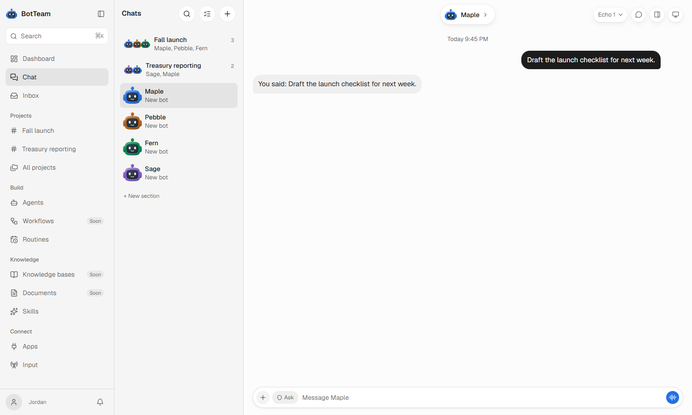
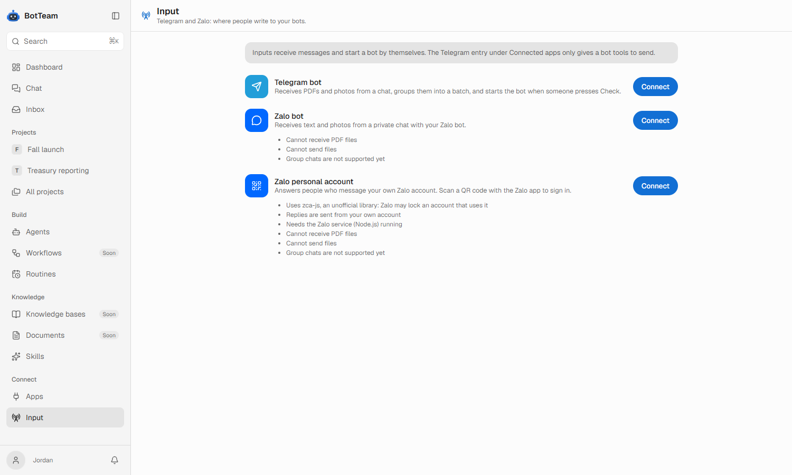
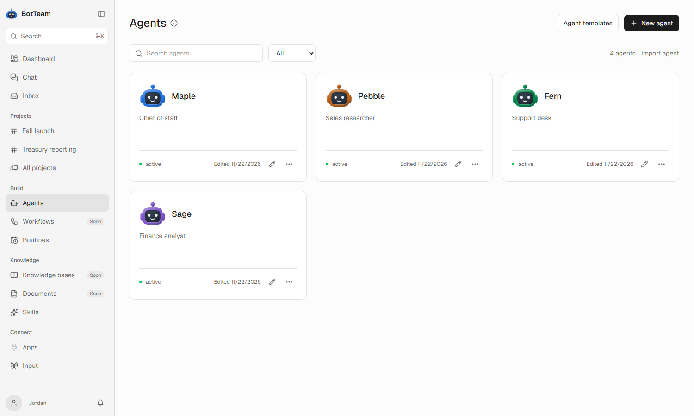
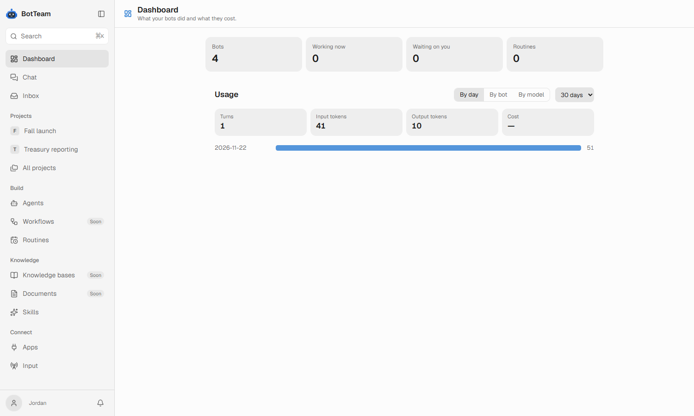
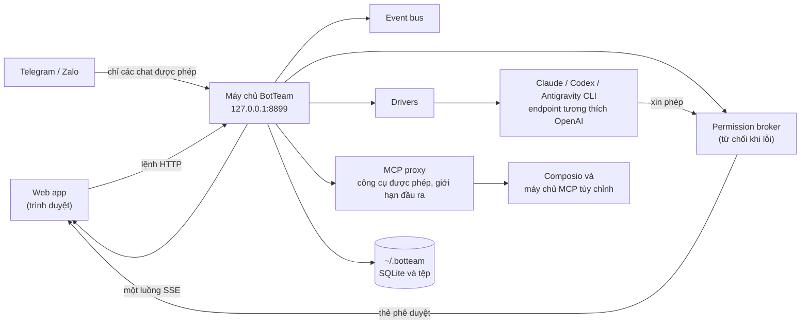

# **BotTeam**

BotTeam là một ứng dụng chat chạy cục bộ, trong đó mỗi liên hệ ở thanh bên là một agent AI thật: Claude Code, Codex hoặc Antigravity CLI (hay bất kỳ endpoint tương thích OpenAI nào) chạy ngay trên máy của bạn, với tên, hướng dẫn, mô hình, bộ nhớ và các ứng dụng kết nối riêng. Các bot làm việc cùng nhau trong kênh, giao việc cho nhau, chạy theo lịch, và trả lời những người nhắn tin cho chúng trên Telegram hoặc Zalo. Mọi thứ đều được lưu trên máy của bạn.

Ứng dụng được xây dựng bằng web app Next.js và máy chủ Python (FastAPI), ban đầu lấy cảm hứng từ [OpenMausBot](https://github.com/milind-soni/OpenMausBot). Giao diện không gian làm việc (workspace) và màn hình Agents theo [agenticos](https://github.com/vstorm-co/agenticos).

[English](README.md) | **Tiếng Việt** (hướng dẫn sử dụng chi tiết: [docs/user-guide.md](docs/user-guide.md))

---

<p align="center"></p>

<table>
  <tr>
    <td width="33%"></td>
    <td width="33%"></td>
    <td width="33%"></td>
  </tr>
</table>

---

## ⚡ Bắt đầu nhanh

**macOS / Linux**

```bash
curl -fsSL https://raw.githubusercontent.com/jokerhung/aiBotTeam/master/install.sh -o install.sh && bash install.sh
```

**Windows (PowerShell)**

```powershell
iwr -useb https://raw.githubusercontent.com/jokerhung/aiBotTeam/master/install.ps1 -OutFile install.ps1; powershell -ExecutionPolicy Bypass -File install.ps1
```

Script cài đặt Git, Node.js, Python và uv nếu còn thiếu, tải mã nguồn về và cài các phụ thuộc. Thêm `--claude` / `-Claude`, `--codex` / `-Codex` hoặc `--antigravity` / `-Antigravity` để cài luôn CLI của các engine. Xem [docs/user-guide.md](docs/user-guide.md) để biết mọi tùy chọn và cách đăng nhập vào một engine.

---

## ✨ 8 điểm mạnh

- 🗂️ **Workspace Agents, Resources và kỹ năng** — thẻ agent có tìm kiếm với trình sửa Save/Discard và 28 mẫu ngoại tuyến, thư viện Toolbox, thư viện kỹ năng với 80 kỹ năng ngành, Resources có quản lý phiên bản (HTML, Markdown, ảnh, bài đăng), cùng bộ nhớ và xuất/nhập một bot hoặc một nhóm bằng một tệp.
- 🤖 **Agent thật, không phải lớp bọc chat** — mỗi bot là một phiên Claude Code, Codex hoặc Antigravity CLI (hoặc endpoint tương thích OpenAI) với mô hình, thư mục làm việc và mức phê duyệt riêng.
- 👥 **Nhóm và kênh** — đưa nhiều bot vào một kênh, `@mention` chúng, và để một bot giao việc cho bot khác.
- ✋ **Thẻ phê duyệt** — trước khi bot chạy lệnh, sửa tệp hoặc gửi thứ gì ra ngoài, bạn quyết định ngay trong chat: Ask, Edits, Auto hoặc Full.
- 🔌 **Ứng dụng kết nối** — kết nối Gmail, Google Sheets, Slack, GitHub và nhiều hơn nữa qua Composio, hoặc thêm máy chủ MCP của riêng bạn.
- 💬 **Đầu vào Telegram và Zalo** (bot Telegram, bot Zalo, hoặc tài khoản Zalo riêng của bạn qua một dịch vụ Node.js) — bot trả lời mọi tin nhắn, hoặc gom ảnh và tệp rồi tự chạy sau 30 giây im lặng (hoặc khi có người bấm *Check*). Cách bot nhận tin nhắn được viết trong tệp `intake.md` ở thư mục làm việc của nó, bạn có thể sửa ở Agents → Availability: tin nhắn tiến độ trong lúc ảnh đến, lưu ảnh vào các thư mục như `<máy>/<ngày>/Truoc|Sau` đọc từ chú thích (tệp giống hệt nhau không lưu hai lần), và một phản hồi ngắn, có hoặc không chạy một bot. Mỗi lô ảnh có một cuộc trò chuyện riêng trong ứng dụng, hiển thị cả mọi thứ đã gửi vào chat, và `run.command` có thể chạy một script trong thư mục làm việc sau đó (ví dụ để tải PDF), thử lại cho tới khi thành công.
- 🖥️ **Trình duyệt tích hợp (Computer)** — bot duyệt web trong cửa sổ riêng của nó; bạn có thể tiếp quản để đăng nhập hoặc giải CAPTCHA rồi trả lại.
- ⏰ **Tự động hóa** — lịch chạy (routine) và webhook khởi chạy bot mà không cần bạn, kèm trang lịch để xem chúng.

---

## 🛡️ Kiến trúc bảo mật



- **Ưu tiên cục bộ.** Máy chủ lắng nghe ở `127.0.0.1`. Các địa chỉ localhost, LAN và Tailscale mở trực tiếp; một tên miền hay địa chỉ công khai cần mã ghép cặp dùng một lần (có hiệu lực 10 phút).
- **Từ chối khi lỗi.** Một yêu cầu cấp quyền không ai trả lời sẽ bị từ chối.
- **Khóa chỉ ghi.** Ứng dụng chỉ cho biết khóa đã được cấu hình. Token của Composio, Telegram và Zalo ở lại trên máy này và không bao giờ xuất hiện trong tệp bot đã xuất.
- **Văn bản bên ngoài là dữ liệu.** Văn bản từ công cụ, trang web, cuộc chat và chú thích ảnh không bao giờ được coi là chỉ thị.
- **Truy cập có giới hạn.** Bot không thể mở các địa chỉ nội bộ (localhost, mạng riêng) trừ khi bạn cho phép; mỗi kết nối có thể giới hạn ở đọc hoặc ghi và theo danh sách công cụ được phép; việc gửi ra ngoài luôn hỏi trước trừ khi bạn nói khác.

---

## 📂 Cấu trúc dự án (Monorepo)

| Đường dẫn | Mục đích |
|---|---|
| `web/` | Ứng dụng Next.js (App Router), React, Tailwind v4: thanh bên, chat, ô soạn tin, các bảng, Connected apps |
| `web/state/` | Reducer duy nhất và client SSE |
| `web/components/layout/` | Bố cục workspace: `AppRail` (menu trái), `PageFrame`, các trang trống và các trang của menu (`pages.tsx`); bản thân menu là bảng trong `web/lib/nav.ts` |
| `web/lib/` | Kiểu dùng chung với máy chủ (`wire.ts`), giao diện (skin), từ điển tiếng Việt (`i18n-vi.ts`) |
| `server/botteam/` | Máy chủ FastAPI: `main.py` (các route), `turns.py`, `registry.py`, `broker.py`, `store.py`, `routines.py`, `memory.py` |
| `server/botteam/drivers/` | Một driver cho mỗi engine: `claude.py`, `codex.py`, `antigravity.py`, `openai_compat.py` |
| `server/botteam/channels/` | Đầu vào bot Telegram, bot Zalo và tài khoản Zalo cá nhân, chế độ lô và chế độ chat |
| `zalo-service/` | Dịch vụ Node.js dựa trên [zca-js](https://github.com/RFS-ADRENO/zca-js): đăng nhập QR, nhận và gửi tin nhắn Zalo cho tài khoản cá nhân; truy cập qua proxy `/zalo-api` trong `web/next.config.mjs` |
| `server/botteam/mcp_*.py`, `composio.py` | Máy chủ MCP, proxy và kết nối Composio |
| `server/tests/` | Các bộ test pytest (driver giả phát lại sự kiện) |
| `scripts/` | Công cụ phụ trợ: `run.mjs`, `free-ports.ps1`, kiểm tra giao diện và so sánh tham chiếu |
| `docs/` | Kế hoạch theo giai đoạn, [hướng dẫn sử dụng](docs/user-guide.md), báo cáo giao diện, các [ví dụ](docs/examples/) về `intake.md` và `machines.md` |
| `specs/` | Đặc tả các thay đổi, như [intake.md](specs/intake-md.md) |
| `workspaces/` | Thư mục làm việc mà BotTeam tạo cho những bot chưa được gán (tạo lúc chạy, không nằm trong git) |
| `install.ps1`, `install.sh`, `start.bat`, `zip-project.ps1` | Các script cài đặt, khởi động và đóng gói |

### Thiết lập môi trường phát triển

#### Yêu cầu

- Python 3.10 trở lên và [uv](https://docs.astral.sh/uv/)
- Node.js 20 trở lên và pnpm
- Git
- Ít nhất một engine: Claude Code CLI, Codex CLI, Antigravity CLI (`agy`, từ antigravity.google), hoặc một endpoint tương thích OpenAI
- Microsoft Edge hoặc Chrome cho trình duyệt tích hợp (nếu không, chạy `playwright install chromium`)

Các script cài đặt kiểm tra tất cả những điều này và cài những gì còn thiếu. Các cổng: web `5299`, API `8899`, webhook `8900`, dịch vụ Zalo `8902`.

#### Windows — PowerShell

**Bắt đầu nhanh:**

```powershell
powershell -ExecutionPolicy Bypass -File install.ps1
.\start.bat
```

**Chỉ chạy một phần:**

```powershell
.\start.bat server   # máy chủ API, có tải lại tự động
.\start.bat web      # web app
.\start.bat one      # web app đã build và API chạy như một chương trình (chạy pnpm build:static trước)
```

`start.bat` giải phóng các cổng của nó trước rồi mới khởi động. Nếu không tìm thấy `pnpm` hoặc `uv` ngay sau khi cài, hãy mở một cửa sổ terminal mới.

#### macOS

```bash
bash install.sh
pnpm dev
```

`pnpm dev` khởi động máy chủ và web app cùng lúc. Hãy mở terminal mới nếu `uv` hoặc `pnpm` không được nhận ra sau khi cài.

Trình khởi chạy máy chủ dùng trực tiếp Python trong `server/.venv` đã cài và chạy mã nguồn hiện tại. Nó không đồng bộ phụ thuộc ở mỗi lần khởi động, nhờ vậy một phiên bản khác đang chạy không thể khóa tệp thực thi mà bước khởi động cố thay thế trên Windows. Sau khi phụ thuộc thay đổi, hãy dừng các phiên bản BotTeam đang chạy và chạy `pnpm setup:server` trước khi khởi động lại. Một bản checkout chưa có môi trường Python vẫn được khởi tạo qua uv. Các script cài đặt đã tự đồng bộ phụ thuộc và không cần thay đổi.

#### Linux

```bash
bash install.sh      # dùng sudo khi bạn không phải root
pnpm dev
```

Để dùng BotTeam từ một máy tính khác trong LAN hoặc Tailscale của bạn, đặt `WEB_HOST=0.0.0.0` trong `.env`, giữ `SERVER_HOST=127.0.0.1`, khởi động lại và mở `http://<ip>:5299`.

#### Mở ứng dụng và cấu hình

1. Mở `http://127.0.0.1:5299` khi phát triển, hoặc `http://127.0.0.1:8899` sau `pnpm build:static` và `botteam serve`.
2. Màn hình chào kiểm tra xem có engine hay chưa. Hãy cài và đăng nhập (`claude`, `codex login`, `agy`) hoặc thêm một endpoint tương thích OpenAI ở Settings → Engines, rồi bấm **Check again**.
3. Bấm **+** → **New bot**, đặt tên và chọn màu.
4. Chọn mức phê duyệt cho bot, và kết nối ứng dụng bằng **Connect apps** (khóa Composio, máy chủ MCP tùy chỉnh, đầu vào Telegram và Zalo). Bot bạn tạo mà không có thư mục làm việc sẽ được cấp `workspaces/<bot id>/`; khi bot được gán một đầu vào, một tệp `intake.md` được tạo ở đó (Bot settings → *Intake workflow* sẽ sửa tệp này).

> ⚠️ Một bot ở mức phê duyệt **Full** có thể chạy bất kỳ lệnh nào trên máy tính của bạn. Hãy dùng **Ask** cho mọi bot nói chuyện với người ngoài nhóm của bạn.

#### Đóng gói và chạy kiểm tra

```bash
pnpm test              # máy chủ (pytest), web (Vitest) và dịch vụ Zalo (node:test)
pnpm typecheck         # TypeScript
pnpm test:ui           # so sánh với tham chiếu và giao diện (cần ứng dụng tham chiếu đang chạy)
pnpm test:workspace      # menu workspace, địa chỉ và ngăn kéo màn hình hẹp (cần ứng dụng đang chạy)
pnpm test:resources      # resources, duyệt phiên bản và routine ghim phiên bản (cần ứng dụng đang chạy)
pnpm test:skills         # di chuyển gallery và giao diện kỹ năng (cần ứng dụng đang chạy; giữ lại các kỹ năng gallery)
pnpm build:static      # web app tĩnh do máy chủ Python phục vụ
```

Dữ liệu của bạn nằm ở `~/.botteam` (đổi bằng `BOTTEAM_DATA_DIR`). Sao lưu bằng Settings → Backup hoặc `botteam backup <tệp>`. Kế hoạch, phạm vi và rủi ro nằm trong [docs/README.md](docs/README.md).

Kỹ năng nằm ở `skills/<id>/SKILL.md`, siêu dữ liệu trong `meta.json` và các tệp đi kèm trong các thư mục tương đối của chúng. Gallery được đóng gói sẵn trong `server/botteam/skill_gallery`, nên việc duyệt và cài đặt thông thường không liên hệ với agenticos. Chỉ trình nhập tường minh mới cần một bản checkout nguồn: `server/.venv/Scripts/python.exe scripts/import-agenticos-skills.py --source-dir _reference/agenticos` (dùng `server/.venv/bin/python` trên macOS/Linux). Nó ghim phiên bản thượng nguồn, xác minh 80 kỹ năng và giữ nguyên giấy phép Apache-2.0 của chúng. Claude nhận mỗi kỹ năng được gán cùng các tệp của nó trong thư mục kỹ năng của lượt chạy; các engine khác nhận một bản sao dưới `.botteam/skills/` của workspace agent và đúng thư mục để tham chiếu đường dẫn tương đối.

Resources hiển thị một thẻ cho mỗi resource. Mở một thẻ để duyệt các phiên bản của nó, rồi chọn một phiên bản để xem chi tiết; đóng chi tiết sẽ quay lại danh sách phiên bản. Các liên kết trực tiếp tới phiên bản từ chat và routine vẫn mở đúng phiên bản đó.

Nội dung resource nằm ở `resources/<resource_id>/v<N>/` bên trong thư mục dữ liệu đó; SQLite chỉ lưu đường dẫn tương đối và siêu dữ liệu. Bản sao lưu bao gồm các tệp này. Thư viện giữ mười phiên bản mới nhất cộng các phiên bản cũ hơn còn được bài đăng, trang HTML hoặc routine tham chiếu. Hỗ trợ tải lên HTML (2 MB), Markdown (500 KB), ảnh PNG/JPEG/GIF/WebP (10 MB), và bài đăng với chú thích tối đa 20.000 ký tự cùng các tham chiếu ảnh có phiên bản. Các phụ thuộc đã khóa của máy chủ có `python-multipart` cho việc tải lên; thiết lập thông thường tự cài đặt nó.

Quy trình mạng xã hội giờ yêu cầu Creator lưu một post resource và chuyển tham chiếu `res_id@vN` đầy đủ cho Scheduler. Scheduler tạo một routine `[DRAFT]` đang tắt trỏ tới phiên bản đó. Hãy xem lại bài, duyệt đúng phiên bản đó, rồi tự bật routine. Tạo v2 không làm thay đổi một routine đã ghim v1. Các phiên bản chưa duyệt hoặc không còn sẽ bị bỏ qua kèm lý do được ghi lại. Các routine nháp hiện có và hướng dẫn tùy chỉnh của agent được giữ nguyên. Xem [Phase 11](docs/phase-11-resources.md) và [bản ghi kiểm chứng](docs/verification/resources.md).

---

## Khả năng của Toolbox

Mỗi agent có Toolbox riêng. Agent mới bắt đầu với Web browser bật, Subagents tắt và Computer use tắt. Lưu các thay đổi khả năng bằng nút **Save** của trình sửa agent. Các bot đang cộng tác hiện có được di chuyển một lần sau khi sao lưu; ứng dụng liệt kê các agent bị ảnh hưởng để bạn xem lại các delegate của chúng.

Subagents hỗ trợ các delegate tường minh, trả kết quả đồng bộ/nền, độ sâu và số luồng song song có giới hạn, chuyên gia nội tuyến (inline specialist) và chuyên gia tạm thời đã được duyệt. Các routine, webhook và kênh không có người trực tiếp dùng các delegate được khai báo tường minh. **Social media team** trong Templates tạo Master cùng bốn delegate. **Duplicate with delegates** tạo một nhóm riêng với workspace mới.

Web browser dùng một hồ sơ riêng và Playwright MCP **0.0.86** qua Node.js/npx. Cần Edge, Chrome hoặc Playwright Chromium (`install.ps1 -Browser` / `install.sh --browser`). Cài đặt trình duyệt điều khiển cửa sổ hiển thị, truy cập mạng nội bộ và tự tắt khi nhàn rỗi. Hồ sơ trình duyệt và các đăng nhập đã lưu bị loại khỏi bản sao lưu và bản xuất. Bảng chat có các tab Browser/Computer và nút Take control / Give it back.

Computer use là tùy chọn: Python **3.11+**, `uv sync --project server --extra computer`, hoặc `install.ps1 -Computer` / `install.sh --computer`. Ở **Settings > Computer host**, cấu hình E2B Cloud/Embed hoặc OpenSandbox và kiểm tra kết nối trước khi bật Computer use. Trình cài đặt thêm các SDK; bạn tự chuẩn bị máy chủ lưu trữ (host). Hướng dẫn thiết lập: [E2B tiếng Anh](docs/e2b-setup.en.md), [E2B tiếng Việt](docs/e2b-setup.vi.md), [OpenSandbox tiếng Anh](docs/opensandbox-setup.en.md), [OpenSandbox tiếng Việt](docs/opensandbox-setup.vi.md). Khóa API ở lại trên máy chủ. Luồng màn hình đi qua BotTeam; không có thông tin xác thực của nhà cung cấp nào đến trình duyệt. Các kiểm tra được ghi tại [Toolbox verification](docs/verification/toolbox-port.md).

---

## 📄 Giấy phép

BotTeam chưa có tệp giấy phép riêng. Các thông báo bên thứ ba nằm trong [NOTICE](NOTICE).

- Kho mã: <https://github.com/jokerhung/aiBotTeam>

Cài đặt dự án có **Maximum automatic handoffs** (số lần giao việc tự động tối đa, 0-50 cấp sau khi một người gửi tin nhắn; mặc định 2). Hãy tăng nếu cần cộng tác dài hơn, hoặc dùng 0 để tắt giao việc tự động. Mỗi mục trong bản ghi cuộc trò chuyện của một phòng giữ tối đa 20.000 ký tự cho việc giao việc.

Quy trình mạng xã hội: Creator lưu chú thích Markdown cuối cùng và các tệp ảnh, sau đó Scheduler tạo một routine `[DRAFT]` đang tắt với toàn bộ chú thích và đường dẫn ảnh đã xác minh (`trigger` với `enabled=false`). Người dùng xem lại và bật công việc trong Routines. Hướng dẫn của nhóm cấm các bot tự bật hoặc chạy các bản nháp này.

Khi một agent mở Browser hoặc Computer của nó, các cuộc trò chuyện chat và project tự động hiển thị một bản xem trước trực tiếp gọn. Mở rộng bản xem trước để có màn hình lớn hơn, chọn **Take over** để gửi thao tác chuột/bàn phím, và **Give it back** để agent tiếp tục. Khung hình trình duyệt chỉ được truyền khi bản xem trước đang được xem; Computer dùng luồng noVNC chỉ-xem sẵn có với đầu vào được ủy quyền riêng.
